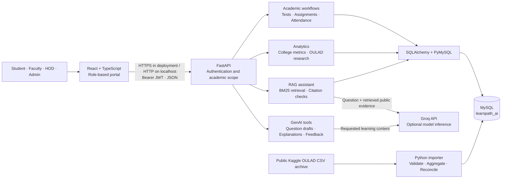

<div align="center">

# LearnPath AI

**Academic assessment, learning analytics, and evidence-grounded AI for engineering colleges.**

A role-based workspace connecting **students, faculty, HODs, and administrators** through React, FastAPI, and MySQL.

[](frontend-react/package.json)
[](backend/requirements.txt)
[](backend/db/001_schema.sql)
[](backend/app/rag.py)

**[Quick start](#quick-start)** · **[Architecture](#architecture)** · **[Repository](#repository)** · **[Dataset & RAG](#dataset--rag)** · **[Documentation](#documentation)**

</div>

## Overview

LearnPath AI brings assessment, classroom attendance, study planning, and learning support into one persistent academic workspace. A separate research explorer uses the public OULAD dataset to demonstrate engagement heatmaps, trends, and historical outcomes.

- **Academic workflows** — question banks, timed tests, assignments, reviewed grading, attendance, and study plans.
- **Role-aware access** — institution administration, department oversight, assigned teaching scopes, and individual student records.
- **Interactive analytics** — heatmaps, line/area graphs, bar charts, outcome distributions, cohort filters, learner drill-downs, and CSV exports.
- **Grounded AI assistance** — MySQL-backed retrieval, inspectable citations, optional Groq generation, and saved conversations.
- **Persistent records** — academic data, research aggregates, and assistant history live in MySQL; schema and reporting SQL are included in the repository.

Risk indicators and study-plan priorities are transparent heuristics. They are not validated predictive models. Generated questions and grading suggestions require faculty review.

## Architecture



The application is a **modular monolith**: one FastAPI process serves APIs and the compiled React application. Academic workflows, analytics, and AI are separate modules within that process; they are not independently deployed microservices.

| Layer | Responsibility | Source |
|---|---|---|
| Presentation | Role layouts, forms, charts, assistant UI | [`frontend-react/src/`](frontend-react/src/) |
| Application/API | Validation, academic workflows, scoped portal snapshots | [`backend/app/main.py`](backend/app/main.py), [`portal.py`](backend/app/portal.py) |
| Security | Argon2id verification, JWTs, role and academic scope checks | [`backend/app/security.py`](backend/app/security.py) |
| Analytics | College reports and isolated public research analytics | [`analytics.py`](backend/app/analytics.py), [`dataset_analytics.py`](backend/app/dataset_analytics.py) |
| AI | Structured GenAI tasks and evidence-grounded assistant | [`ai.py`](backend/app/ai.py), [`rag.py`](backend/app/rag.py) |
| Persistence | MySQL schema, transactions, imports, reporting queries | [`backend/app/db.py`](backend/app/db.py), [`backend/db/`](backend/db/) |

[Read the architecture and data-flow guide →](backend/docs/architecture.md)

## Repository

```text
Neural-Code-Ninjas/
├── frontend-react/                 Active React + TypeScript application
│   ├── src/
│   │   ├── components/             Shared UI controls, tables, navigation
│   │   ├── context/AppContext.tsx  Authenticated API client and workspace state
│   │   ├── layouts/                Student, Faculty, HOD, Admin shells
│   │   ├── pages/
│   │   │   ├── Login.tsx           Database-backed sign-in
│   │   │   ├── LivePages.tsx       Connected academic workflow screens
│   │   │   ├── DatasetAnalytics.tsx  OULAD research explorer
│   │   │   └── RagAssistant.tsx    Cited assistant and saved history
│   │   └── App.tsx                Routing and role guards
│   ├── package.json               Frontend scripts and dependencies
│   └── vite.config.ts             Build configuration and development proxy
├── backend/
│   ├── app/                       FastAPI application modules
│   ├── db/                        MySQL schemas, migrations, query packs
│   ├── scripts/                   Database setup, imports, account utilities
│   ├── tests/                     MySQL integration tests
│   ├── docs/                      Architecture and implementation guides
│   ├── data/oulad/                Dataset provenance and import manifest
│   ├── .env.example               Configuration template; no real secrets
│   ├── Dockerfile                 React build + Python runtime image
│   └── compose.yaml               MySQL and API service definitions
├── frontend/                      Preserved legacy frontend at /legacy
├── start-project.ps1              Existing local showcase launcher
├── .gitignore                     Excludes secrets, runtime data, dependencies
└── README.md
```

The active workflow screens are `LivePages.tsx`, `DatasetAnalytics.tsx`, and `RagAssistant.tsx`. Older design-preview page files remain in the source tree for reference. `dist/`, virtual environments, dependencies, raw archives, and local database files are generated locally and excluded from Git.

## Role workspaces

| Role | Main responsibilities | Private academic access |
|---|---|---|
| Student | Take tests, submit assignments, review results, track study plans | Own authorized academic records |
| Faculty | Manage questions and assessments, record attendance, grade submissions | Assigned subjects and sections |
| HOD | Review departmental performance and learning gaps | Department scope |
| Admin | Manage users, academic structure, enrollment and teaching mappings | Institution administration |

All roles can explore the **public research dataset** and use the **AI Knowledge Assistant**. Conversation history is owner-scoped, including when the requesting user is an administrator. Choosing a role on the login screen does not grant that role.

## Quick start

### Fresh clone: manual setup

Prerequisites: **Python 3.12+**, **Node.js 22+ with npm**, and a running **MySQL 8.0.16+** server. The Docker configuration uses MySQL 8.4. Configure a dedicated database user with the permissions needed for schema setup; use a suitably restricted account for runtime access.

```powershell
git clone https://github.com/Yash301201/Neural-Code-Ninjas.git
cd Neural-Code-Ninjas

cd frontend-react
npm ci
npm run build
cd ..\backend

python -m venv .venv
.\.venv\Scripts\python.exe -m pip install -r requirements.txt
Copy-Item .env.example .env
.\.venv\Scripts\python.exe -c "import secrets; print(secrets.token_urlsafe(48))"
```

Edit `backend/.env`: set `DATABASE_URL` to your MySQL connection and replace `JWT_SECRET` with the generated value. URL-encode special characters in database credentials. Do not overwrite an existing local configuration when updating an installation.

```powershell
# From backend/; --create-database requires CREATE DATABASE permission.
.\.venv\Scripts\python.exe -m scripts.init_db --create-database
.\.venv\Scripts\python.exe -m scripts.create_admin
.\.venv\Scripts\python.exe -m uvicorn app.main:app --host 127.0.0.1 --port 8001
```

If `learnpath_ai` already exists and the account has no server-level creation permission, omit `--create-database`. Use the admin workspace to create academic structure, users, enrollment, and faculty assignments. Public self-registration and email password recovery are not configured.

| Service | Local URL |
|---|---|
| Application | [http://127.0.0.1:8001/app/](http://127.0.0.1:8001/app/) |
| Interactive API docs | [http://127.0.0.1:8001/docs](http://127.0.0.1:8001/docs) |
| Health check | [http://127.0.0.1:8001/health](http://127.0.0.1:8001/health) |
| Legacy UI | [http://127.0.0.1:8001/legacy](http://127.0.0.1:8001/legacy) |

### Existing Windows showcase installation

For the previously configured installation with its virtual environment and private local MySQL directory, run from the project root:

```powershell
powershell -ExecutionPolicy Bypass -File .\start-project.ps1
# Rebuild after frontend changes:
powershell -ExecutionPolicy Bypass -File .\start-project.ps1 -Rebuild
```

The launcher expects the existing machine-specific MySQL setup; it does not provision a fresh clone. Stop the old backend before restarting after Python or `.env` changes. For frontend development, run `npm run dev` in `frontend-react/`; Vite serves port 3000 and proxies `/api` to port 8001.

## Dataset & RAG

### Research analytics pipeline

The [OULAD Kaggle mirror](https://www.kaggle.com/datasets/rocki37/open-university-learning-analytics-dataset) supplies historical Open University research data. The imported reference batch contains **32,593 course enrollments**, **28,785 distinct learners**, **22 course cohorts**, and **10,655,280 VLE activity records**.

```powershell
# From backend/, after database initialization:
.\.venv\Scripts\python.exe -m scripts.download_oulad
.\.venv\Scripts\python.exe -m scripts.import_oulad
.\.venv\Scripts\python.exe -m scripts.setup_rag
```

The importer streams the archive, avoids duplicate CSV copies, aggregates weekly engagement, reconciles totals, and exposes only completed `READY` batches. Research tables use the `oulad_` prefix and do not create login accounts.

OULAD is historical UK data from 2013–2014, attributed to **Kuzilek, Hlosta, and Zdrahal**, under **CC BY 4.0**. See the [official dataset documentation](https://archive.ics.uci.edu/dataset/349/open+university+learning+analytics+dataset). Andhra/Telugu display names are fictional aliases. VLE clicks measure online activity, not classroom attendance.

### Grounded assistant

```mermaid
sequenceDiagram
    actor User
    participant UI as React assistant
    participant API as FastAPI /api/rag
    participant DB as MySQL
    participant LLM as Groq
    User->>UI: Ask a question and optionally select a cohort
    UI->>API: Authenticated question
    API->>DB: Read public knowledge chunks
    DB-->>API: Source text and provenance
    Note over API: BM25 ranks relevant chunks
    alt API key configured and generation requested
        API->>LLM: Question + retrieved evidence
        LLM-->>API: Answer with source labels
        Note over API: Validate citation labels; fall back on failure
    else Evidence-only mode or missing key
        Note over API: Return explicitly labeled source excerpts
    end
    API->>DB: Save owner-scoped conversation and evidence snapshot
    API-->>UI: Answer mode, answer, citations
```

The reference index contains **905 chunks** covering public research aggregates and curated project guidance. Retrieval uses **BM25 lexical ranking**, not embeddings or a vector database. The assistant does not retrieve private grades, credential files, password hashes, or JWT keys, and cannot execute database writes through the model.

To enable Groq generation, configure these existing entries privately in `backend/.env`, then restart the backend:

```dotenv
LLM_API_KEY=your_groq_api_key
LLM_BASE_URL=https://api.groq.com/openai/v1
LLM_MODEL=llama-3.3-70b-versatile
```

Without a working key, retrieval remains available and is clearly distinguished from generated answers. After importing a new dataset batch, refresh the index with `scripts.setup_rag` or the admin refresh button. Stored conversations retain their original evidence snapshots. Each question is retrieved independently; saved history is not conversational model memory.

## Database & security

| Data domain | MySQL storage | Definition |
|---|---|---|
| Academic records | Users, courses, enrollment, tests, submissions, attendance, study plans | [`001_schema.sql`](backend/db/001_schema.sql) |
| Calendar | Academic events | [`003_calendar.sql`](backend/db/003_calendar.sql) |
| Public research | `oulad_*` source and aggregate tables | [`005_oulad_analytics.sql`](backend/db/005_oulad_analytics.sql) |
| Assistant | `rag_chunks`, `rag_conversations`, `rag_messages` | [`007_rag_assistant.sql`](backend/db/007_rag_assistant.sql) |

SQL files define the database; MySQL holds live application rows. Database initialization and additive schema updates are explicit commands, not automatic API-startup migrations. Reporting query packs are separate from schema setup. Back up existing databases before applying DDL.

- Passwords use **Argon2id hashes**; **HS256 JWTs** represent expiring sessions, not password storage.
- FastAPI enforces role and academic scope; browser route guards provide navigation behavior.
- `get_db()` commits successful requests and rolls back failures; SQLAlchemy binds query parameters.
- Provider keys and database credentials remain server-side. `.env` and `.local/` are excluded from version control.
- Generated assessment content requires faculty review. Citations can be inspected but do not guarantee every generated claim is correct.

## Development & verification

```powershell
# Frontend, from frontend-react/:
npm ci
npm run build

# Backend, from backend/:
# Set TEST_DATABASE_URL to a disposable MySQL database ending in _test.
.\.venv\Scripts\python.exe -m pytest tests -q
```

The test suite recreates its target schema and refuses databases whose names do not end in `_test`. Never point tests at application data.

Recorded local verification: **16 backend tests passed** and the TypeScript/Vite production build passed. Coverage includes academic permissions, assessment workflows, dataset totals, RAG fallback, citation-label validation, and conversation ownership. Live Groq generation requires a configured key and has not been verified; Docker runtime and college-scale load testing have not been verified.

Docker build and Compose definitions are supplied in [`backend/`](backend/). See the backend setup guide for required environment variables. Container initialization scripts run only for a fresh MySQL volume.

## Documentation

- [Architecture and folder responsibilities](backend/docs/architecture.md)
- [Backend setup and API workflows](backend/README.md)
- [Frontend integration notes](backend/docs/react-integration.md)
- [OULAD import, attribution, and analytics](backend/docs/oulad-integration.md)
- [Groq, RAG, and MySQL persistence](backend/docs/rag-integration.md)
- [Credential storage](backend/docs/credential-storage.md)
- [Academic reporting queries](backend/db/004_project_queries.sql)
- [OULAD reporting queries](backend/db/006_oulad_reporting_queries.sql)
- [Assistant reporting queries](backend/db/008_rag_reporting_queries.sql)

## Contributing

Keep presentation changes in `frontend-react/`, API behavior in `backend/app/`, and schema/query changes in `backend/db/`. Include matching database updates when a feature introduces persistent data. Document configuration changes, run the checks relevant to the change, and keep credentials and runtime data out of commits.

## Authors

**Neural Code Ninjas**

- [@Yash301201](https://github.com/Yash301201)
- [@Ramana8800](https://github.com/Ramana8800)
- [@Harshini256](https://github.com/Harshini256)
- [@Raviteja2425](https://github.com/Raviteja2425)
