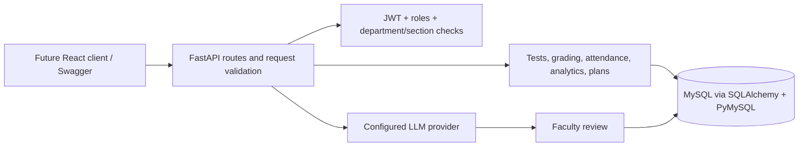

# Complete frontend + backend

The project now includes a frontend in the adjacent `frontend` folder. To start the full showcase, run the root `start-project.ps1` and open http://127.0.0.1:8001/app. See `../README.md` for the current complete-project instructions. The backend-only setup and original phase notes below are retained for reference; frontend work is now implemented.

# Ready on this computer

The backend is already installed in `.venv`. A separate local MySQL 8.0 instance has been initialized on **127.0.0.1:3307**, with the `learnpath_ai` database, all schema files and fictional sample data. Existing MySQL services were not modified.

From this backend folder run:

```powershell
powershell -ExecutionPolicy Bypass -File .\start-local.ps1
```

Open http://127.0.0.1:8000/docs. The generated local administrator email and password are in `.local/admin-login.txt`. Log in through `POST /auth/login`, then paste the returned token into **Authorize**. The fictional sample accounts have unusable placeholder hashes; create login-enabled faculty/student accounts using `/users` and map their enrollments/teaching assignments. Local configuration is already in `.env`.

Press Ctrl+C to stop the API. MySQL remains running for this project. To stop that database only, run `powershell -ExecutionPolicy Bypass -File .\stop-local-db.ps1`. The next start script restarts it. Project data is in `.local/mysql-data`; do not remove it. `.env` and `.local` hold private local configuration and are excluded from Git and Docker. The virtual environment and local MySQL binary paths are machine-specific; use the instructions below on another machine. Avoid OneDrive synchronizing an active MySQL data directory; shut down this instance before copying/backing up the folder.

---

# LearnPath AI - MySQL and FastAPI backend

Backend implementation of the supplied LearnPath AI brief. Existing parent files are preserved. Start here; run all commands from this `backend` directory. Python 3.12+ and MySQL 8.0.16+ are required. Frontend work is outside this backend phase.

## Local setup (PowerShell)

```powershell
python -m venv .venv
.\.venv\Scripts\python -m pip install -r requirements.txt
Copy-Item .env.example .env
python -c "import secrets; print(secrets.token_urlsafe(48))"
```

Put the generated value into `JWT_SECRET` in `.env`. Set `DATABASE_URL` to your actual MySQL credentials. URL-encode special characters in passwords. Create a dedicated database user with permissions on `learnpath_ai`; do not use root for the running API.

Database files are supplied first, and the API reflects that schema through SQLAlchemy:

1. `db/001_schema.sql`: departments, courses, sections, users, enrollments, teaching assignments, subjects, topics, questions, tests, attempts, answers, assignments, submissions, attendance, study plans, risk predictions, AI history and three reporting views.
2. `db/003_calendar.sql`: academic calendar events.
3. `db/002_sample_data.sql`: optional fictional examples. Load once into a fresh database. Its placeholder password hashes cannot log in.

With credentials permitted to create the database:

```powershell
.\.venv\Scripts\python -m scripts.init_db --create-database
# Optional, only in a fresh schema:
.\.venv\Scripts\python -m scripts.init_db --sample-data
.\.venv\Scripts\python -m scripts.create_admin
.\.venv\Scripts\python -m uvicorn app.main:app --reload
```

Alternatively run the schema and calendar SQL in MySQL Workbench, then omit database initialization. Startup checks the schema and fails clearly if it is missing. No schema is silently created by the API. DDL implicitly commits in MySQL, so back up before applying changes to existing data. These are baseline SQL migrations, not an automatic versioned migration system.

Open http://127.0.0.1:8000/docs for interactive Swagger documentation. `/openapi.json` supplies the machine-readable contract. `/health` checks database connectivity.

## Workflow

1. `POST /auth/login` with JSON `email` and `password`. Copy `access_token` into Swagger's **Authorize** bearer field.
2. As administrator create departments, courses, sections, users and academic events. Create subjects and topics; enroll students and assign faculty to a subject/section. There is no public registration or public privilege escalation.
3. Assigned faculty create questions and tests. LLM questions enter `PENDING_REVIEW`; use the review endpoint to approve them before creating a test. Publish the test with its status endpoint.
4. Students list tests using `subject_id` and `section_id`, start an attempt, fetch its questions, and submit answers. Objective options use exact canonical option strings. Answer keys and explanations are removed from student question responses. Published test questions are frozen against editing.
5. Objective answers are graded automatically. Descriptive answers keep the attempt `SUBMITTED` until faculty grades every answer. Missing objective answers receive zero. Grade limits are checked against maximum marks.
6. Faculty create assignments, review text submissions and grade them. Deadlines are enforced. Each student submits once per assignment. Attendance records require active enrollment in the selected section.
7. Performance, section dashboards and department learning gaps expose topic scores and attendance. Study plans prioritize weak or unassessed topics and store progress per item.

All assessment timestamps use UTC without an offset. Clients should convert local times to UTC before sending. Duration and test open/close windows are enforced on submission; expired attempts remain visible as `IN_PROGRESS` but cannot submit. Further attempt allocation remains subject to the configured attempt count. Catalog deletion is deliberately excluded to preserve academic history; accounts can be disabled.

## AI and GenAI

Two working local decision-support features need no external key: weighted early-warning risk scoring and personalized topic prioritization. They are transparent **heuristics**, not trained ML models. Risk uses 70% assessment deficit and 30% attendance deficit, renormalizing when an indicator is missing; no observations yields an insufficient-data response. LOW <35, MEDIUM <60, HIGH >=60. These indicators need faculty review and have no measured predictive accuracy.

Three LLM workflows are implemented: question generation, English/Telugu doubt explanations, and descriptive-answer feedback. Configure `LLM_API_KEY`, `LLM_BASE_URL` and `LLM_MODEL` for an OpenAI-compatible chat-completions provider. Provider access incurs its normal costs. Without a key these endpoints return 503; no fabricated fallback output is presented. Generated JSON is validated before storage. Faculty approves generated questions and final grades. No student names are sent in prompts; answers/questions are sent for the requested AI task. Use fictional data as required by the brief.

## Docker alternative

Install Docker Desktop. Add `MYSQL_PASSWORD` and `MYSQL_ROOT_PASSWORD` (random URL-safe values) to `.env` alongside `JWT_SECRET`. Then:

```powershell
docker compose up --build -d
docker compose exec api python -m scripts.create_admin
```

The MySQL volume persists data. Initialization SQL runs only when the volume is new. The database is reachable only inside the Compose network; API binds to localhost. Sample data is opt-in. Do not delete a volume containing data you need.

## Validation and scope

`python -m pytest -q` runs integration tests against an isolated MySQL database. Set `TEST_DATABASE_URL` to a **disposable** database ending `_test`; tests refuse other names, recreate its schema and remove rows. Never use an existing database. See `docs/verification.md` for the validation actually performed here.

Role and academic scope checks cover all private academic workflows. Argon2 hashes, expiring HS256 JWTs, bound SQLAlchemy queries and strict request models are used. Deploy behind HTTPS and add infrastructure login rate limiting before exposing publicly. The project supplies the backend; a frontend, a trained/validated ML model, and live provider verification are separate follow-up work. No GitHub repository has been published.

## Architecture



Implementation references: [FastAPI security](https://fastapi.tiangolo.com/tutorial/security/oauth2-jwt/) and [SQLAlchemy reflection](https://docs.sqlalchemy.org/en/20/core/reflection.html).

Project reporting queries: db/004_project_queries.sql contains 21 LearnPath AI queries. Run it in MySQL Workbench after the schema; change the IDs at the top to select your records.
