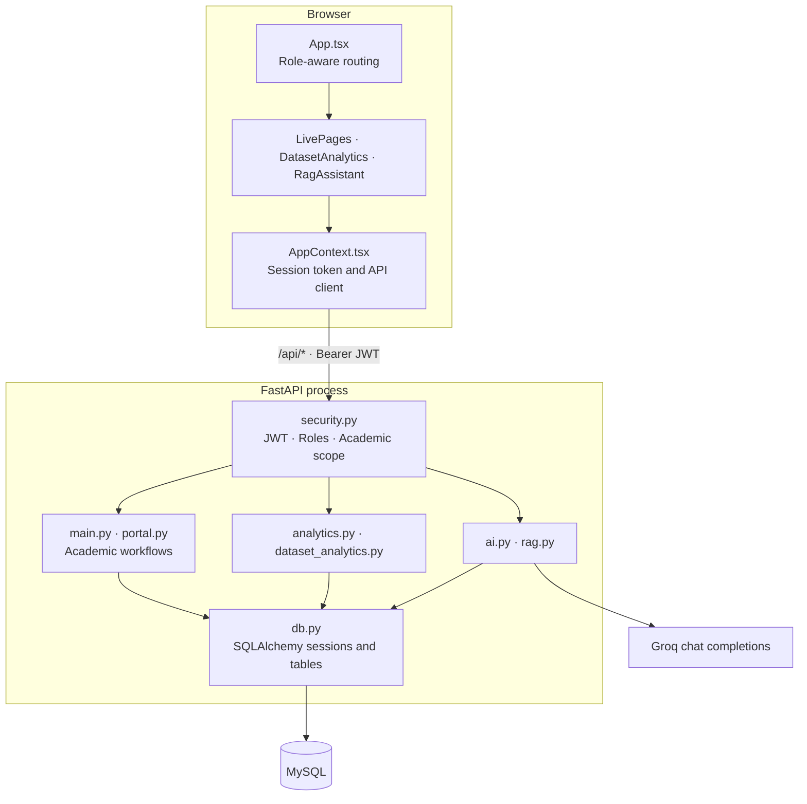
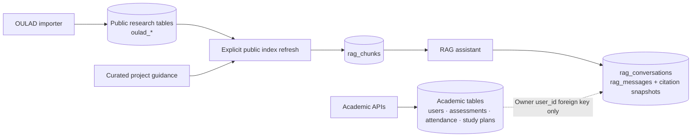

# LearnPath AI architecture

[Back to repository overview](../../README.md)

## Deployment model

LearnPath AI is a modular monolith. A FastAPI process serves JSON APIs and React static assets. MySQL is the system of record. Groq is an optional external inference service. The dataset downloader/importer and RAG index setup are explicit Python command-line operations.

These boxes describe code responsibilities, not separate network services. `main.py` currently contains much of the academic CRUD and assessment orchestration. There is no message broker, background worker tier, separate vector store, or trained prediction service in the implementation.

## Folder and module ownership

| Folder/module | Owns | Change here when… |
|---|---|---|
| `frontend-react/src/components/` | Reusable controls and navigation | A shared UI pattern changes |
| `frontend-react/src/layouts/` | Four role shells and sidebar navigation | A role gets a new screen |
| `frontend-react/src/context/AppContext.tsx` | Authenticated API calls, session and workspace state | Client API/session behavior changes |
| `frontend-react/src/pages/LivePages.tsx` | Connected academic workflow views | Tests, attendance, assignments or administration UI changes |
| `frontend-react/src/pages/DatasetAnalytics.tsx` | Public research charts and filters | Research visualization changes |
| `frontend-react/src/pages/RagAssistant.tsx` | Assistant interaction and history | Evidence display or assistant controls change |
| `backend/app/main.py` | Core endpoints, application lifecycle, frontend routes | Academic API or HTTP application behavior changes |
| `backend/app/portal.py` | Authorized workspace snapshots and portal operations | A role's workspace data changes |
| `backend/app/security.py` | Password checks, tokens and authorization | Access rules change |
| `backend/app/analytics.py` | Private academic reporting and heuristic support | College metrics or study prioritization changes |
| `backend/app/dataset_analytics.py` | Public OULAD cohort queries and fictional aliases | Research calculations change |
| `backend/app/ai.py` | Structured model tasks with validation | Tutor, question generation or feedback changes |
| `backend/app/rag.py` | Public index, BM25 retrieval, provider calls and history | Retrieval or grounding changes |
| `backend/app/db.py` | Engine, sessions and shared persistence helpers | Database connection or transaction handling changes |
| `backend/db/` | Schema definitions and reporting SQL | Persistent structures or report queries change |
| `backend/scripts/` | Explicit setup, account and import commands | Operational setup or ingestion changes |
| `backend/tests/` | Disposable-MySQL integration verification | API behavior or data access changes |
| `backend/data/oulad/` | Provenance and reference import manifest | Dataset provenance changes |
| `frontend/` | Preserved legacy UI | Maintaining the `/legacy` compatibility interface |

## Request and transaction flow

1. `App.tsx` selects a role layout; FastAPI remains authoritative for permissions.
2. The API client sends JSON and a bearer token to `/api/*`. The browser keeps its session token in `sessionStorage`.
3. `current_user` verifies the token and active account. Role and subject/student access helpers enforce the requested academic scope.
4. Request models validate input. Endpoint code reads or writes MySQL through SQLAlchemy.
5. The database dependency commits after a successful request or rolls back on an exception.
6. React renders returned records and refreshes workspace data when required.

FastAPI also exposes original routes without the `/api` alias. `/app/` serves the active SPA, `/app/assets/` its compiled assets, and nested SPA routes support direct navigation. Vite's development proxy points `/api` to the local backend on port 8001.

## Persistence boundaries

All groups live in the same configured MySQL database, but their purposes and access paths are distinct. Public OULAD records are not application users. The assistant's managed knowledge index contains public aggregates and curated text, not private academic tables. History uses the application user's ID for ownership without including account credentials in model context.

Academic changes are persisted by their normal endpoints. An OULAD import creates a batch whose analytics become visible only after completion. A subsequent explicit RAG refresh updates indexed evidence. Existing answer citations remain immutable snapshots; an index refresh does not rewrite earlier answers.

## Retrieval and model behavior

`rag.py` reads eligible chunks from MySQL, applies an optional cohort filter, and uses BM25 lexical ranking to select up to five matching sources. It does not call an embedding API or use a vector index. The current corpus is small enough for in-process ranking; larger collections would require retrieval profiling and a more scalable index.

Generation sends the user's question and retrieved sources to the configured chat-completions provider. The system instruction limits answers to that evidence. Source labels are checked against retrieved IDs. A missing key, provider error, or invalid citation labels yields explicitly labeled excerpts; unmatched queries return an insufficient-evidence message. Valid labels alone do not establish factual entailment.

Conversations and message pairs are stored in MySQL. History is accessible only to its owner. Each submitted question is retrieved independently; earlier messages are not passed as model memory. The model has no SQL tool or permission to change assessments or account records.

## Schema and operational lifecycle

- `001_schema.sql`: academic baseline and reporting views.
- `002_sample_data.sql`: optional fictional seed data; load once into a fresh schema.
- `003_calendar.sql`: academic calendar.
- `005_oulad_analytics.sql`: public source/import and aggregate tables.
- `007_rag_assistant.sql`: knowledge chunks and owner-scoped assistant history.
- `004`, `006`, and `008`: read-only reporting query packs, not migrations.

`scripts.init_db` applies schema files explicitly. `scripts.setup_rag` applies the additive RAG schema and refreshes the public index after an OULAD import is available. MySQL DDL implicitly commits; these scripts are not an automatic migration-history framework. Compose initialization runs only on a fresh database volume. Existing volumes require intentional schema updates.

`backend/.env` and `backend/.local/` are private runtime state. They are not source artifacts. The local Windows launcher expects its existing MySQL installation and data directory; a fresh clone must use the manual setup or configured container workflow.

## Validation and current limits

The recorded implementation check passed 16 MySQL-backed tests and the TypeScript/Vite production build. Tests cover authorization, academic workflows, research totals, retrieval fallback, citation labels and conversation ownership. A test database name must end in `_test`; tests recreate its schema.

Live Groq inference requires a valid API key and remains unverified in the recorded run. Docker execution and institution-scale performance are unverified. There is no configured email delivery, public self-registration, or validated outcome-prediction model. Classroom attendance and historical VLE engagement must be interpreted separately.
